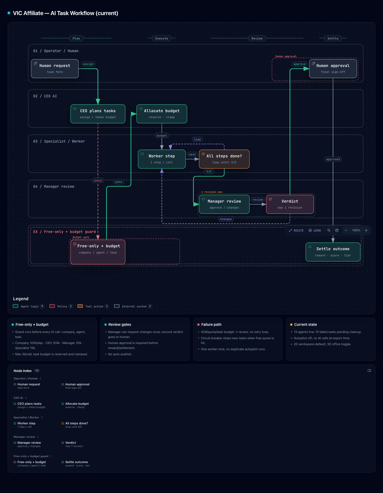

# VIC Affiliate — Multi-Agent AI Company Console

A control plane for a multi-channel content and affiliate business: YouTube, TikTok,
Facebook, books, media channels, Shopee, TikTok Shop and international storefronts.
It combines a free-only AI router, an AI company hierarchy, token budgets, human
approval gates, a 2D multi-agent workspace, a 3D office view and a media job queue.

**Documentation languages:** English (primary) · [Tiếng Việt](README.vi.md)

## Stack

- **Framework:** Next.js 16 (App Router, Turbopack), TypeScript, Tailwind CSS v4
- **Data & auth:** Supabase (Postgres, Auth, Row Level Security)
- **AI:** multi-provider router with free-only guard
  (OpenCode Zen, Google Gemini, Groq, OpenRouter; paid providers blocked by default)
- **Automation:** Playwright autopilot on macOS, Agent Reach research CLI
- **Media:** `media_jobs` queue + Windows worker for voice/music
- **Diagrams:** Archify, exported as standalone interactive HTML

## Current features

- **Multi-agent workspace:** 2D organization tree by default, with a toggle to the
  3D office. The workspace shows agents, live status, token usage, dependencies,
  quick actions and an inspector panel.
- **AI company hierarchy:** CEO → managers → specialists, persisted in
  `companies` / `ai_agents`. Tasks are assigned to agents, require approval and
  settle rewards, score and tier after human review.
- **Company-scoped modules:** Knowledge, Channels, Connections and Revenue are
  opened from each company's subnav and filtered by `company_id`; the global
  sidebar only hosts the portfolio, shared knowledge, AI Studio and settings.
- **Free-only AI routing:** `AI_FREE_ONLY=1` blocks paid models/providers at
  runtime. The fallback order is OpenCode Zen → Google Gemini → Groq → OpenRouter.
- **Token budgets:** company, CEO, manager, specialist, worker and per-task
  budgets; per-call output cap; one manager revision round; circuit breaker on
  429/quota; one worker lock; cost ledger.
- **Human approval:** AI output is never auto-published. Approved work can settle
  salary, score and tier; rejected work loses score/reward.
- **Research and tools:** Agent Reach (read-only web/GitHub/YouTube research),
  optional Browser MCP for real signed-in Chrome sessions, and Archify for
  architecture documentation.
- **Skills & SOP:** affiliate product research, affiliate review and short-video
  storyboard skills with deterministic quality gates; a pinned affiliate SOP is
  injected into company knowledge.
- **Media pipeline:** voice/music jobs are queued in Supabase and processed by a
  Windows worker. A MoneyPrinterTurbo video renderer is planned, not wired yet.
- **REST API:** `/api/channels`, `/api/channels/[id]`, `/api/ai/generate`,
  `/api/admin/users`.

## Architecture

Interactive diagrams (dark by default):

- [Current AI company runtime — English](docs/architecture/current-ai-company.en-dark.html)
- [Current task workflow — English](docs/architecture/current-task-workflow.en-dark.html)
- [Current AI company runtime — Vietnamese](docs/architecture/current-ai-company.vi.html)
- [Current task workflow — Vietnamese](docs/architecture/current-task-workflow.vi.html)

### Diagram snapshots

Click a snapshot to open the interactive diagram.

[](docs/architecture/current-ai-company.en-dark.html)

[](docs/architecture/current-task-workflow.en-dark.html)

Written overview:

- [Architecture — English](docs/ARCHITECTURE.md)
- [Kiến trúc — Tiếng Việt](docs/ARCHITECTURE.vi.md)

Archify source candidates and validation receipts are under `.archify/` and
`docs/architecture/`. The checked English artifacts are
`current-ai-company.en.html` and `current-task-workflow.en.html`; the `.en-dark.html`
files are presentation copies with dark as the default theme. To regenerate the
diagrams, install Archify with `npx skills add tt-a1i/archify -g` and use the
commands in [Validation](#validation).

## Quick start

### Requirements

- Node.js 20+ and npm
- A Supabase project
- Python 3.10+ and `uv` only if you use Agent Reach
- Chrome/Edge/Brave only if you use Browser MCP
- macOS only for the Playwright autopilot

### 1. Install dependencies

```bash
npm install
```

### 2. Configure Supabase

1. Create a project at [supabase.com](https://supabase.com).
2. Run every SQL file in `supabase/migrations/` in order, or use the Supabase CLI:

```bash
supabase db push
```

3. Copy the environment template:

```bash
cp .env.example .env.local
```

4. Fill in the required values:

| Variable | Required | Notes |
| --- | --- | --- |
| `NEXT_PUBLIC_SUPABASE_URL` | Yes | Supabase → Project Settings → API |
| `NEXT_PUBLIC_SUPABASE_ANON_KEY` | Yes | Supabase → Project Settings → API |
| `AI_FREE_ONLY` | Recommended | `1` blocks paid providers/models |
| `AI_PROVIDER_ORDER` | No | Defaults to `opencode,google,groq,openrouter` |
| `OPENCODE_API_KEY` | For OpenCode free | Key used only to authenticate free Zen models |
| `GOOGLE_API_KEY` | For Gemini free | Google AI Studio key |
| `GROQ_API_KEY` | For Groq free | Groq console key |
| `OPENROUTER_API_KEY` | For OpenRouter free | Use a `:free` model or `openrouter/free` |
| `TOKEN_ENCRYPTION_KEY` | For OAuth channels | `openssl rand -base64 32` |
| `AUTOPILOT_EMAIL` / `AUTOPILOT_PASSWORD` | Autopilot only | Supabase test account |
| `AUTOPILOT_COMPANY_IDS` | Autopilot only | Comma-separated company IDs |

The committed `.env.example` documents every supported variable. Do not commit
`.env.local` or real API keys.

### 3. Run

```bash
npm run dev
```

Open [http://localhost:3000](http://localhost:3000), register the first account,
then run the following in Supabase SQL Editor to make it the platform owner:

```sql
update public.profiles
set role = 'super_admin'
where email = 'you@example.com';
```

Sign in again to see the Admin area.

## AI configuration

The default development configuration is free-only:

```env
AI_FREE_ONLY=1
AI_PROVIDER_ORDER=opencode,google,groq,openrouter

OPENCODE_BASE_URL=https://opencode.ai/zen/v1
OPENCODE_MODEL=deepseek-v4.1-flash-free

GOOGLE_MODEL=gemini-3.8-flash
GROQ_MODEL=qwen/qwen3.8-27b
OPENROUTER_MODEL=openrouter/free

AI_DAILY_TOKEN_LIMIT=100000
AI_AGENT_DAILY_TOKEN_LIMIT=15000
AI_TASK_TOKEN_LIMIT=15000
AI_MAX_TOKENS_PER_CALL=3000
AI_MAX_REVIEW_ROUNDS=1
```

Paid providers (`openai`, `anthropic`, `opencode` Go endpoint, OpenRouter paid
models) are rejected by the router while `AI_FREE_ONLY=1`. Do not disable the
guard unless you explicitly intend to spend paid credits.

Provider-specific model overrides live in `.env.local`; the UI also lets you set a
free model per agent. The router only passes a per-agent model override to the
provider that owns it, so fallback providers keep their own defaults.

## Token budgets

The budget hierarchy is enforced in `lib/ai/token-budget.ts` and checked before
every AI call:

| Scope | Default | Notes |
| --- | ---: | --- |
| Company | 100,000 / day | CEO can allocate this pool to tasks |
| CEO | 100,000 / day | Planning and audit calls |
| Manager | 20,000 / day | Manager reviews |
| Specialist | 15,000 / day | Research, writing, SEO |
| Worker | 5,000 / day | Small operational tasks |
| Task | 15,000 | Allocated by the CEO when planning |
| Per call | 3,000 | Output token ceiling |
| Review rounds | 1 | Max one manager revision |

Open task budgets are reserved so consecutive planner runs do not over-allocate.
Budget exhaustion, quota 429s and provider failures stop the task and send it to
review instead of retrying indefinitely.

## Roles and workspaces

- **super_admin** — platform owner. Manages admin accounts, sees every workspace
  and is the only role that can access `/admin` or change roles.
- **admin** — workspace owner. Creates and manages its own AI companies, agents,
  channels, knowledge and budgets; cannot see another owner's data.
- **user** — member/viewer. No workspace data until a workspace membership model
  is added.

The tenant boundary is `owner_id`. Company modules are further scoped by
`company_id`. A demo admin should get its own demo company, never global admin
access to real data.

## AI company and task lifecycle

1. The CEO agent plans tasks and allocates a `token_budget` to each task.
2. The budget guard checks company, agent and task limits before every call.
3. A specialist runs one workflow step at a time.
4. The manager reviews the completed workflow. It can request one revision.
5. A human approves or rejects the task.
6. Approved work settles reward, score and tier; rejected work loses score/reward.

Current workflow diagram:
[English](docs/architecture/current-task-workflow.en-dark.html) ·
[Vietnamese](docs/architecture/current-task-workflow.vi.html)

## 2D workspace and 3D office

Open `/company/[id]`:

- A company subnav exposes Overview, Agents, Tasks, Knowledge, Channels,
  Connections, Revenue and Settings.
- **Multi-Agent 2D** is the default: organization tree, status rail, inspector,
  dependencies, quick actions and agent tabs.
- **Văn phòng 3D** switches to the existing 3D office scene.
- `?headless=1` is intended for background automation. It does not start AI by
  itself; the “Tự động” toggle still controls autopilot.

The 2D workspace and the bottom task/report panels use a dark island theme. The
3D view keeps the original light shell and 3D office. Legacy channels start
unassigned; open the company Channels page and assign them to the owning company.

## Autopilot

The autopilot is a **macOS Playwright worker** that opens the company page,
enables “Tự động” and lets the server run one step per tick. It is opt-in and is
not started by `npm run dev`.

```bash
# start
nohup node services/autopilot/mac-autopilot.mjs > /tmp/vic-autopilot.log 2>&1 &

# inspect
tail -f /tmp/vic-autopilot.log

# stop
pkill -f mac-autopilot.mjs
```

It uses a file lock to prevent two copies from running. The server also has an
in-process lock for `autoRunNext`, so duplicate calls are ignored. The autopilot
must never be used as a way to spend paid credits.

## Skills and SOP

Project-local OpenCode skills:

```text
.opencode/skills/affiliate-product-research/
.opencode/skills/affiliate-review/
.opencode/skills/short-video-storyboard/
```

Each skill has a `SKILL.md`, zero-dependency Node scripts and a self-test. Run
the tests with:

```bash
for f in .opencode/skills/*/scripts/selftest.mjs; do node "$f"; done
```

Useful commands:

```bash
node .opencode/skills/affiliate-product-research/scripts/score.mjs candidates.json \
  --out shortlist.json --markdown shortlist.md

node .opencode/skills/affiliate-review/scripts/check.mjs draft.md --meta meta.json

node .opencode/skills/short-video-storyboard/scripts/check.mjs storyboard.json
```

The skills are loaded by OpenCode after a restart. The pinned “SOP Affiliate:
Research, Review, Video” knowledge document is injected into AI company prompts
immediately.

## Research and browser tools

- **Agent Reach** is installed locally. It is read-only and can search/read the
  web, GitHub and YouTube transcripts without a model download.
- **Browser MCP** server and Chrome extension are optional. Use a dedicated
  browser profile; do not use banking/email tabs. The extension must be allowed
  once from its popup.
- **MoneyPrinterTurbo** is a planned video renderer. It is not part of the current
  runtime. When added, it should run as a separate CPU worker, not inside
  Vercel/serverless.

## Media worker

The web app creates voice/music jobs in `media_jobs`. A Windows worker picks them
up, runs the local engines and uploads files to Supabase Storage:

- Music: ACE-Step 1.5 (GGUF, CPU)
- Vietnamese voice: VieNeu-TTS
- Worker: `services/worker` (Node, service-role key stays on the worker machine)

See [services/windows/README.md](services/windows/README.md).

## Project structure

```text
app/
  (auth)/            Sign in / sign up
  (app)/             Authenticated console
    company/         AI company workspace (2D + 3D)
    knowledge/       AI knowledge base
    revenue/         Revenue and expenses
    channels/        Channel management
  actions/           Server Actions (auth, company, tasks, AI)
  api/               REST API
components/          UI kit, workspace, 3D office, task list
lib/
  ai/                Router, free-model catalog, budgets, providers
  supabase/          Browser/server clients and session refresh
  workflows.ts       Workflow steps and state helpers
supabase/migrations  Schema, RLS, triggers, token budgets
services/            Autopilot, media worker, research tools
.opencode/skills/    Project-local agent skills
docs/                Architecture docs and interactive diagrams
.archify/            Archify source JSON and finalize receipts
```

## Security notes

- Supabase RLS is the primary data boundary. Keep the service-role key on
  server/worker machines only.
- Never commit `.env.local`, autopilot credentials or provider keys.
- The autopilot and Browser MCP can drive a signed-in browser. Use a dedicated
  browser profile and stop the agent when not needed.
- Free-only mode protects against accidental paid calls, but review
  `AI_PROVIDER_ORDER` and model overrides before enabling autopilot.
- Rotate any key that has been pasted into chat, logs or screenshots.
- Human approval is the release gate for content and publishing.

## Validation

```bash
npx tsc --noEmit
node .opencode/skills/affiliate-product-research/scripts/selftest.mjs
node .opencode/skills/affiliate-review/scripts/selftest.mjs
node .opencode/skills/short-video-storyboard/scripts/selftest.mjs
```

Archify diagrams are validated with:

```bash
node .agents/skills/archify/bin/archify.mjs finalize architecture \
  .archify/architecture-current-en-20261028/candidate.json \
  docs/architecture/current-ai-company.en.html --quality showcase --json

node .agents/skills/archify/bin/archify.mjs finalize workflow \
  .archify/workflow-current-task-en-20261028/candidate.json \
  docs/architecture/current-task-workflow.en.html --quality showcase --json
```

## Roadmap

- Wire the public affiliate site and `/go` click tracking.
- Add a real product research connector (Kalodata/TikTok Shop or public search).
- Wire MoneyPrinterTurbo as a separate video render worker.
- Add bilingual UI copy (the documentation is already English-first; UI copy is
  currently Vietnamese).
- Add company templates for Film, Accounting and Software/Code teams.
- Add automated tests for the task lifecycle and budget guard.
- Add a LICENSE file before publishing as a public open-source project.

## License

No `LICENSE` file is currently present. Add an explicit license (for example MIT
or Apache-2.0) before distributing this repository publicly. Third-party
components and skills retain their own licenses and attributions.
