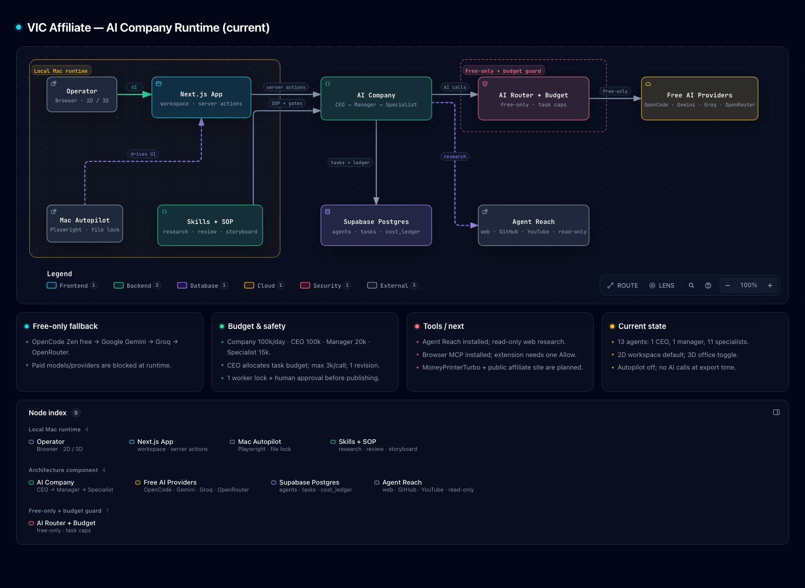
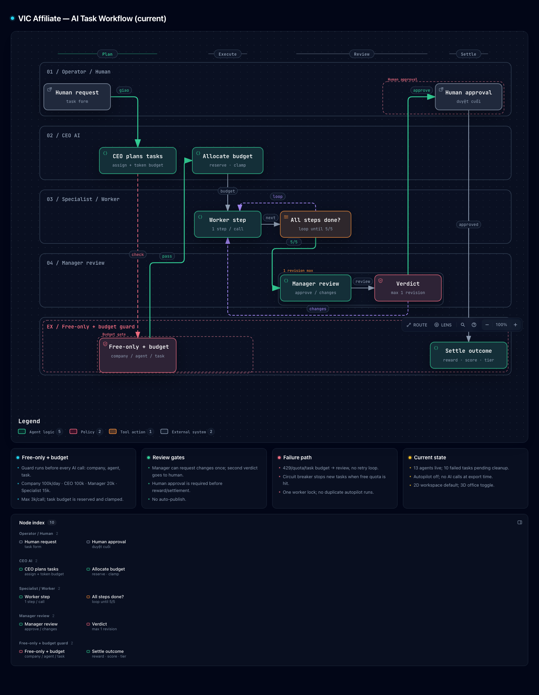

# VIC Affiliate — Bảng điều khiển công ty AI đa tác nhân

Bảng điều khiển cho hệ sinh thái kinh doanh nội dung và affiliate đa kênh: YouTube,
TikTok, Facebook, sách, kênh truyền thông, Shopee, TikTok Shop và các sàn quốc tế.
Hệ thống gồm AI router free-only, cấu trúc công ty AI, ngân sách token, cổng duyệt
của con người, workspace đa tác nhân 2D, văn phòng 3D và hàng đợi media.

**Ngôn ngữ tài liệu:** [English](README.md) (bản chính) · Tiếng Việt

## Công nghệ

- **Framework:** Next.js 16 (App Router, Turbopack), TypeScript, Tailwind CSS v4
- **Dữ liệu & xác thực:** Supabase (Postgres, Auth, Row Level Security)
- **AI:** router đa provider với free-only guard
  (OpenCode Zen, Google Gemini, Groq, OpenRouter; provider trả phí bị chặn mặc định)
- **Tự động hoá:** Playwright autopilot trên macOS, Agent Reach research CLI
- **Media:** hàng đợi `media_jobs` + worker Windows cho voice/music
- **Sơ đồ:** Archify, xuất HTML tương tác độc lập

## Tính năng hiện tại

- **Workspace đa tác nhân:** cây tổ chức 2D mặc định, chuyển sang văn phòng 3D.
  Workspace hiển thị agent, trạng thái, token đã dùng, dependencies, quick actions
  và inspector panel.
- **Công ty AI phân cấp:** CEO → quản lý → chuyên viên, lưu trong `companies` /
  `ai_agents`. Task giao cho agent, mặc định chờ duyệt; sau khi con người duyệt mới
  settle thưởng, điểm và tầng.
- **Module theo công ty:** Tri thức, Kênh, Kết nối và Doanh thu được mở từ subnav
  của từng công ty và lọc theo `company_id`; sidebar global chỉ còn portfolio,
  tri thức dùng chung, AI Studio và cài đặt.
- **AI router free-only:** `AI_FREE_ONLY=1` chặn model/provider trả phí ở runtime.
  Fallback: OpenCode Zen → Google Gemini → Groq → OpenRouter.
- **Ngân sách token:** theo công ty, CEO, manager, specialist, worker và từng task;
  giới hạn output mỗi lượt; tối đa 1 vòng sửa; circuit breaker khi 429/quota;
  một worker lock; ghi sổ cost ledger.
- **Human approval:** AI không tự đăng. Việc được duyệt mới settle lương/điểm/tầng;
  việc bị từ chối bị trừ điểm/thưởng.
- **Research & tools:** Agent Reach (đọc web/GitHub/YouTube, read-only), Browser MCP
  tuỳ chọn cho Chrome đã đăng nhập, Archify cho tài liệu kiến trúc.
- **Skills & SOP:** skill research sản phẩm affiliate, review affiliate và
  storyboard video ngắn với quality gate deterministic; SOP affiliate được ghim
  trong knowledge của công ty.
- **Media pipeline:** job voice/music lưu trong Supabase, worker Windows xử lý.
  MoneyPrinterTurbo là renderer video dự kiến, chưa nối vào runtime.
- **REST API:** `/api/channels`, `/api/channels/[id]`, `/api/ai/generate`,
  `/api/admin/users`.

## Kiến trúc

Sơ đồ tương tác (dark mặc định):

- [Kiến trúc runtime hiện tại — English](docs/architecture/current-ai-company.en-dark.html)
- [Workflow task hiện tại — English](docs/architecture/current-task-workflow.en-dark.html)
- [Kiến trúc runtime hiện tại — Tiếng Việt](docs/architecture/current-ai-company.vi.html)
- [Workflow task hiện tại — Tiếng Việt](docs/architecture/current-task-workflow.vi.html)

### Ảnh sơ đồ

Bấm vào ảnh để mở sơ đồ tương tác.

[](docs/architecture/current-ai-company.vi.html)

[](docs/architecture/current-task-workflow.vi.html)

Tài liệu dạng chữ:

- [Architecture — English](docs/ARCHITECTURE.md)
- [Kiến trúc — Tiếng Việt](docs/ARCHITECTURE.vi.md)

Source JSON và receipt kiểm định Archify nằm trong `.archify/` và
`docs/architecture/`. Bản English đã kiểm định là
`current-ai-company.en.html` và `current-task-workflow.en.html`; các file
`.en-dark.html` là bản trình bày dark mặc định. Để tạo lại sơ đồ, cài Archify bằng
`npx skills add tt-a1i/archify -g` và dùng lệnh trong mục [Kiểm tra](#kiểm-tra).

## Chạy nhanh

### Yêu cầu

- Node.js 20+ và npm
- Project Supabase
- Python 3.10+ và `uv` nếu dùng Agent Reach
- Chrome/Edge/Brave nếu dùng Browser MCP
- macOS nếu dùng Playwright autopilot

### 1. Cài dependencies

```bash
npm install
```

### 2. Cấu hình Supabase

1. Tạo project tại [supabase.com](https://supabase.com).
2. Chạy toàn bộ file SQL trong `supabase/migrations/` theo thứ tự, hoặc dùng CLI:

```bash
supabase db push
```

3. Copy biến môi trường:

```bash
cp .env.example .env.local
```

4. Điền các giá trị bắt buộc:

| Biến | Bắt buộc | Ghi chú |
| --- | --- | --- |
| `NEXT_PUBLIC_SUPABASE_URL` | Có | Supabase → Project Settings → API |
| `NEXT_PUBLIC_SUPABASE_ANON_KEY` | Có | Supabase → Project Settings → API |
| `AI_FREE_ONLY` | Nên bật | `1` chặn provider/model trả phí |
| `AI_PROVIDER_ORDER` | Không | Mặc định `opencode,google,groq,openrouter` |
| `OPENCODE_API_KEY` | Nếu dùng OpenCode free | Chỉ dùng để xác thực model Zen free |
| `GOOGLE_API_KEY` | Nếu dùng Gemini free | Key từ Google AI Studio |
| `GROQ_API_KEY` | Nếu dùng Groq free | Key từ Groq console |
| `OPENROUTER_API_KEY` | Nếu dùng OpenRouter free | Dùng model `:free` hoặc `openrouter/free` |
| `TOKEN_ENCRYPTION_KEY` | Nếu dùng OAuth kênh | `openssl rand -base64 32` |
| `AUTOPILOT_EMAIL` / `AUTOPILOT_PASSWORD` | Chỉ autopilot | Tài khoản Supabase test |
| `AUTOPILOT_COMPANY_IDS` | Chỉ autopilot | Danh sách company ID, cách nhau dấu phẩy |

File `.env.example` liệt kê toàn bộ biến. Không commit `.env.local` hoặc key thật.

### 3. Chạy

```bash
npm run dev
```

Mở [http://localhost:3000](http://localhost:3000), đăng ký tài khoản đầu tiên, sau
đó chạy trong Supabase SQL Editor để cấp quyền chủ platform:

```sql
update public.profiles
set role = 'super_admin'
where email = 'you@example.com';
```

Đăng nhập lại để thấy khu vực Admin.

## Cấu hình AI

Cấu hình development mặc định là free-only:

```env
AI_FREE_ONLY=1
AI_PROVIDER_ORDER=opencode,google,groq,openrouter

OPENCODE_BASE_URL=https://opencode.ai/zen/v1
OPENCODE_MODEL=deepseek-v4.1-flash-free

GOOGLE_MODEL=gemini-3.8-flash
GROQ_MODEL=qwen/qwen3.8-27b
OPENROUTER_MODEL=openrouter/free

AI_DAILY_TOKEN_LIMIT=100000
AI_AGENT_DAILY_TOKEN_LIMIT=15000
AI_TASK_TOKEN_LIMIT=15000
AI_MAX_TOKENS_PER_CALL=3000
AI_MAX_REVIEW_ROUNDS=1
```

Các provider trả phí (`openai`, `anthropic`, endpoint OpenCode Go, model OpenRouter
trả phí) bị router từ chối khi `AI_FREE_ONLY=1`. Không tắt guard trừ khi bạn thực
sự muốn tiêu credit trả phí.

Model override theo từng agent nằm trong `.env.local`; UI cũng cho đặt model free
cho từng AI. Router chỉ truyền override cho đúng provider sở hữu model đó, nên
provider fallback vẫn dùng model mặc định của nó.

## Ngân sách token

Ngân sách được enforce trong `lib/ai/token-budget.ts` và kiểm tra trước mọi lượt gọi:

| Phạm vi | Mặc định | Ghi chú |
| --- | ---: | --- |
| Công ty | 100.000 / ngày | CEO chia pool này cho task |
| CEO | 100.000 / ngày | Lập kế hoạch và audit |
| Manager | 20.000 / ngày | Review của quản lý |
| Specialist | 15.000 / ngày | Research, viết, SEO |
| Worker | 5.000 / ngày | Việc nhỏ |
| Task | 15.000 | CEO cấp khi lập kế hoạch |
| Mỗi lượt gọi | 3.000 | Trần output |
| Vòng sửa | 1 | Tối đa 1 lần manager yêu cầu sửa |

Budget của task đang mở được giữ chỗ để các lần lập kế hoạch liên tiếp không cấp
trùng. Hết budget, 429/quota hoặc provider lỗi sẽ dừng task và chuyển review thay
vì retry vô hạn.

## Vai trò và workspace

- **super_admin** — chủ platform. Quản lý các admin, thấy mọi workspace và là vai
  trò duy nhất vào `/admin` hoặc đổi quyền.
- **admin** — chủ workspace. Tạo/quản lý công ty AI, agent, kênh, tri thức và
  ngân sách của riêng mình; không thấy dữ liệu của chủ khác.
- **user** — thành viên/viewer. Chưa có dữ liệu workspace cho đến khi có mô hình
  membership.

Ranh giới tenant là `owner_id`; module công ty lọc thêm theo `company_id`. Tài
khoản demo admin phải có công ty demo riêng, không dùng admin toàn hệ thống để
xem dữ liệu thật.

## Công ty AI và vòng đời task

1. CEO lập kế hoạch và cấp `token_budget` cho từng task.
2. Budget guard kiểm tra công ty, agent và task trước mỗi lượt gọi.
3. Specialist chạy từng bước workflow.
4. Manager review khi workflow xong; được yêu cầu sửa tối đa 1 lần.
5. Con người duyệt hoặc từ chối.
6. Task được duyệt settle thưởng/điểm/tầng; bị từ chối bị trừ điểm/thưởng.

Sơ đồ workflow:
[English](docs/architecture/current-task-workflow.en-dark.html) ·
[Tiếng Việt](docs/architecture/current-task-workflow.vi.html)

## Workspace 2D và văn phòng 3D

Mở `/company/[id]`:

- Subnav công ty gồm Tổng quan, Agents, Nhiệm vụ, Tri thức, Kênh, Kết nối,
  Doanh thu và Cấu hình.
- **Multi-Agent 2D** là mặc định: cây tổ chức, status rail, inspector,
  dependencies, quick actions và agent tabs.
- **Văn phòng 3D** chuyển sang scene văn phòng 3D hiện có.
- `?headless=1` dành cho automation nền. Nó không tự bật AI; nút “Tự động” vẫn là
  công tắc của autopilot.

Workspace 2D và các panel task/report bên dưới dùng dark island. View 3D giữ light
shell và văn phòng 3D như cũ. Kênh cũ bắt đầu ở trạng thái chưa gán; mở trang Kênh
của công ty để gán về đúng công ty.

## Autopilot

Autopilot là **Playwright worker trên macOS**: mở trang công ty, bật “Tự động” và
để server chạy từng bước. Nó là opt-in, không tự chạy khi `npm run dev`.

```bash
# bật
nohup node services/autopilot/mac-autopilot.mjs > /tmp/vic-autopilot.log 2>&1 &

# xem log
tail -f /tmp/vic-autopilot.log

# dừng
pkill -f mac-autopilot.mjs
```

Autopilot dùng file lock để không chạy 2 bản. Server cũng có in-process lock cho
`autoRunNext`, nên call trùng bị bỏ qua. Không dùng autopilot để tiêu credit trả phí.

## Skills và SOP

Skill project-local cho OpenCode:

```text
.opencode/skills/affiliate-product-research/
.opencode/skills/affiliate-review/
.opencode/skills/short-video-storyboard/
```

Mỗi skill có `SKILL.md`, script Node zero-dependency và self-test. Chạy test:

```bash
for f in .opencode/skills/*/scripts/selftest.mjs; do node "$f"; done
```

Lệnh hữu ích:

```bash
node .opencode/skills/affiliate-product-research/scripts/score.mjs candidates.json \
  --out shortlist.json --markdown shortlist.md

node .opencode/skills/affiliate-review/scripts/check.mjs draft.md --meta meta.json

node .opencode/skills/short-video-storyboard/scripts/check.mjs storyboard.json
```

Skill được OpenCode load sau khi restart. Tài liệu “SOP Affiliate: Research, Review,
Video” đã ghim trong knowledge và được inject vào prompt của công ty AI ngay.

## Research và browser tools

- **Agent Reach** đã cài local. Read-only, tìm/đọc web, GitHub và transcript YouTube,
  không tải model.
- **Browser MCP** server + Chrome extension là tuỳ chọn. Dùng browser profile riêng;
  không dùng tab banking/email. Extension cần Allow một lần từ popup.
- **MoneyPrinterTurbo** là renderer video dự kiến, chưa thuộc runtime hiện tại. Khi
  thêm, nên chạy như CPU worker riêng, không chạy trong Vercel/serverless.

## Media worker

Web tạo job voice/music trong `media_jobs`. Worker Windows nhận job, chạy engine
local và upload file lên Supabase Storage:

- Nhạc: ACE-Step 1.5 (GGUF, CPU)
- Giọng đọc tiếng Việt: VieNeu-TTS
- Worker: `services/worker` (Node, service-role key nằm trên máy worker)

Xem [services/windows/README.md](services/windows/README.md).

## Cấu trúc thư mục

```text
app/
  (auth)/            Đăng nhập / đăng ký
  (app)/             Console đã xác thực
    company/         Workspace công ty AI (2D + 3D)
    knowledge/       Kho tri thức AI
    revenue/         Doanh thu và chi phí
    channels/        Quản lý kênh
  actions/           Server Actions (auth, company, task, AI)
  api/               REST API
components/          UI kit, workspace, 3D office, task list
lib/
  ai/                Router, free-model catalog, budget, provider
  supabase/          Client browser/server, refresh session
  workflows.ts       Workflow step và state helper
supabase/migrations  Schema, RLS, trigger, token budget
services/            Autopilot, media worker, research tool
.opencode/skills/    Skill project-local
docs/                Tài liệu kiến trúc và sơ đồ tương tác
.archify/            Source JSON và receipt finalize của Archify
```

## Bảo mật

- RLS của Supabase là ranh giới dữ liệu chính. Chỉ giữ service-role key trên
  server/worker.
- Không commit `.env.local`, credential autopilot hoặc provider key.
- Autopilot và Browser MCP có thể điều khiển browser đã đăng nhập. Dùng profile
  riêng và dừng agent khi không cần.
- Free-only bảo vệ khỏi gọi trả phí ngoài ý muốn, nhưng vẫn kiểm tra
  `AI_PROVIDER_ORDER` và model override trước khi bật autopilot.
- Rotate mọi key từng xuất hiện trong chat, log hoặc screenshot.
- Human approval là cổng phát hành nội dung.

## Kiểm tra

```bash
npx tsc --noEmit
node .opencode/skills/affiliate-product-research/scripts/selftest.mjs
node .opencode/skills/affiliate-review/scripts/selftest.mjs
node .opencode/skills/short-video-storyboard/scripts/selftest.mjs
```

Sơ đồ Archify được kiểm định bằng:

```bash
node .agents/skills/archify/bin/archify.mjs finalize architecture \
  .archify/architecture-current-en-20261028/candidate.json \
  docs/architecture/current-ai-company.en.html --quality showcase --json

node .agents/skills/archify/bin/archify.mjs finalize workflow \
  .archify/workflow-current-task-en-20261028/candidate.json \
  docs/architecture/current-task-workflow.en.html --quality showcase --json
```

## Roadmap

- Nối public affiliate site và tracking click `/go`.
- Thêm connector research sản phẩm thật (Kalodata/TikTok Shop hoặc public search).
- Nối MoneyPrinterTurbo thành worker render video riêng.
- Hoàn thiện i18n cho message backend và workflow template.
- Thêm template công ty Phim, Kế toán và Phần mềm/Code.
- Thêm test tự động cho task lifecycle và budget guard.

## Đóng góp

Đọc [CONTRIBUTING.md](CONTRIBUTING.md) để biết cách cài đặt, các bước kiểm tra
và checklist pull request. PR nhỏ, tập trung một vấn đề sẽ dễ review hơn.

## Bảo mật

Vui lòng báo lỗ hổng bảo mật riêng qua GitHub Security Advisories. Xem
[SECURITY.md](SECURITY.md) để biết phạm vi và quy trình xử lý.

## License

Phát hành theo [MIT License](LICENSE). Các thành phần/skill bên thứ ba giữ
license và attribution riêng.

## Contributors

Cảm ơn mọi người đã đóng góp cho Autonomous AI Company Platform.

<p align="center">
  <a href="https://github.com/BoyKa74/Autonomous_AI_Company_Platform/graphs/contributors">
    
  </a>
</p>
